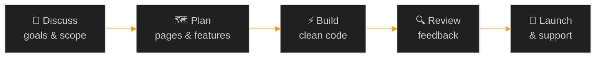

<div align="center">


### I turn business ideas into fast, reliable web products.


<br />

**[About](#about) &nbsp;/&nbsp; [Services](#services) &nbsp;/&nbsp; [Work](#selected-work) &nbsp;/&nbsp; [Stack](#how-it-fits-together) &nbsp;/&nbsp; [Process](#process) &nbsp;/&nbsp; [Contact](#start-a-project)**

<br />

<a href="https://zeshan-portfolio-ousy.vercel.app/"></a>
<a href="mailto:zeshanzahid202@gmail.com?subject=Project%20Inquiry"></a>

</div>

<!-- LinkedIn: add your profile to the "Start a Project" section once you have the exact URL. -->

<br />

## About

```bash
$ whoami
Zeshan Zahid · Full Stack Developer

$ cat profile.txt
company      Neffto IT Solutions
location     Pakistan
frontend     React.js, Next.js, Tailwind CSS
backend      Node.js, Express.js, REST APIs
database     MongoDB
interests    SaaS products, AI-powered solutions
building     UniEraX (in development)
status       Open to client projects and collaborations
```

I work on both sides of a product: the responsive interface people use and the backend that powers it. My goal is simple. Clear communication, clean code, and websites or apps that are easy for your customers to use.

<br />

## Services

| | What you need | What I build |
| :-: | :-- | :-- |
| 🌐 | A website that represents your business | **Business websites & landing pages**: clean, fast, mobile-friendly |
| ⚛️ | A modern web application | **React.js & Next.js apps** with reusable components |
| 🔌 | Logic and data behind your product | **Backend development & REST APIs** with Node.js and Express.js |
| 🗄️ | A place to store and manage data | **Database integration** with MongoDB |
| 📱 | A design that works on every screen | **Responsive UI implementation** for phones, tablets and desktops |
| 🔧 | An existing site that needs work | **Improvements & maintenance**: updates, fixes and refinements |

<br />

## Selected Work

| # | Project | What it is | Status | Link |
| :-: | :-- | :-- | :-: | :-: |
| `01` | **Neffto IT Solutions** | A technology and digital solutions business. | `Live` | [Visit Website ↗](https://nefftosolution.com/) |
| `02` | **Developer Portfolio** | My portfolio showcasing my development work, skills and projects. | `Live` | [View Portfolio ↗](https://zeshan-portfolio-ousy.vercel.app/) |
| `03` | **Student Planner** | A student-focused project for organizing study tasks and learning activities. | `Demo` | [Try Demo ↗](http://student-planer.vercel.app/login) |
| `04` | **Truck Dispatching** | A project related to truck dispatching services. | `Live` | [View Project ↗](https://burraqdispatch.vercel.app/) |
| `05` | **UniEraX** | An evolving technology platform concept focused on digital services and innovative products. | `In Development` | Coming soon |

<br />

## How It Fits Together

The stack I work with, from the browser to the database:


<div align="center">


</div>

<br />

| Category | Technologies |
| :-- | :-- |
| **Frontend** | HTML5 · CSS3 · JavaScript · React.js · Next.js · Tailwind CSS · Bootstrap |
| **Backend** | Node.js · Express.js · REST APIs |
| **Database** | MongoDB |
| **Tools** | Git · GitHub · VS Code · Figma |

<br />

## Process



<details>
<summary><b>📝 What to send me when you start a project</b></summary>

<br />

- What your business or idea does
- The type of project (website, web app, API, or improvements to an existing site)
- Pages or features you need
- Design references or brand assets, if you have them
- Your preferred timeline

</details>

<br />

## GitHub Activity

<div align="center">


</div>

<br />

## Start a Project

<div align="center">

### Have an idea or an existing site that needs work?
Tell me about it and I'll get back to you.

<br />

<a href="mailto:zeshanzahid202@gmail.com?subject=Project%20Inquiry"></a>
<a href="https://zeshan-portfolio-ousy.vercel.app/"></a>
<a href="https://nefftosolution.com/"></a>

<br /><br />

`zeshanzahid202@gmail.com` &nbsp;·&nbsp; 💼 LinkedIn: *coming soon*


</div>
