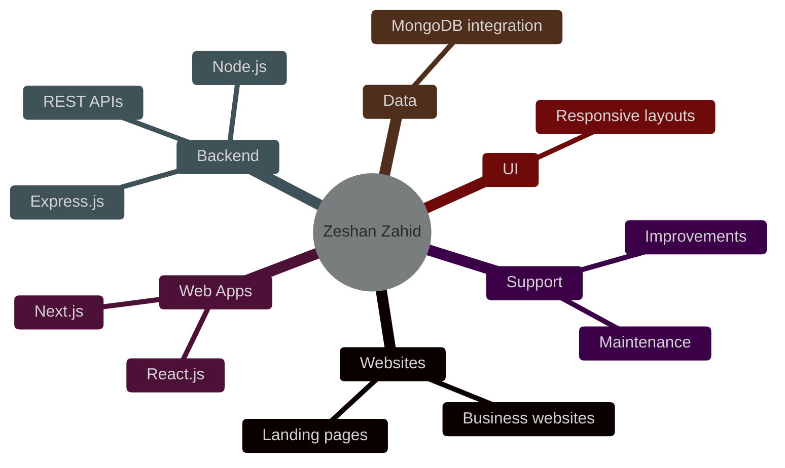
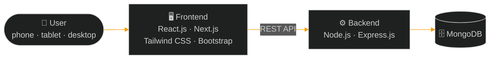
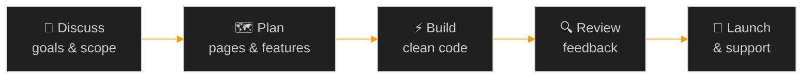

<div align="center">


### I turn business ideas into fast, reliable web products.


<br />

**[About](#about) &nbsp;/&nbsp; [Services](#services) &nbsp;/&nbsp; [Work](#selected-work) &nbsp;/&nbsp; [Stack](#how-it-fits-together) &nbsp;/&nbsp; [Process](#process) &nbsp;/&nbsp; [FAQ](#faq) &nbsp;/&nbsp; [Contact](#start-a-project)**

<br />

<a href="https://zeshan-portfolio-ousy.vercel.app/"></a>
<a href="mailto:zeshanzahid202@gmail.com?subject=Project%20Inquiry&body=Hi%20Zeshan%2C%0A%0AProject%20type%3A%0ABusiness%20or%20idea%3A%0APages%20or%20features%20needed%3A%0APreferred%20timeline%3A%0A%0AThanks"></a>

<br /><br />


</div>

<!-- LinkedIn: add your profile to the "Start a Project" section once you have the exact URL. -->

<br />

## About

```json
{
  "name": "Zeshan Zahid",
  "role": "Full Stack Developer",
  "company": "Neffto IT Solutions",
  "location": "Pakistan",
  "available_for_hire": true,
  "builds": ["Business websites", "Web applications", "REST APIs"],
  "stack": ["React.js", "Next.js", "Node.js", "Express.js", "MongoDB"],
  "interests": ["SaaS products", "AI-powered solutions"],
  "currently_building": "UniEraX (in development)",
  "reply_to": "zeshanzahid202@gmail.com"
}
```

I work on both sides of a product: the responsive interface people use and the backend that powers it. I care about clear communication, clean code, and websites or apps that are easy for your customers to use.

<br />

## Services



| | What you need | What I build | Ask about it |
| :-: | :-- | :-- | :-: |
| 🌐 | A website that represents your business | **Business websites & landing pages**: clean, fast, mobile-friendly | [Enquire ↗](mailto:zeshanzahid202@gmail.com?subject=Website%20or%20Landing%20Page%20Inquiry) |
| ⚛️ | A modern web application | **React.js & Next.js apps** with reusable components | [Enquire ↗](mailto:zeshanzahid202@gmail.com?subject=Web%20Application%20Inquiry) |
| 🔌 | Logic and data behind your product | **Backend development & REST APIs** with Node.js and Express.js | [Enquire ↗](mailto:zeshanzahid202@gmail.com?subject=Backend%20and%20API%20Inquiry) |
| 🗄️ | A place to store and manage data | **Database integration** with MongoDB | [Enquire ↗](mailto:zeshanzahid202@gmail.com?subject=Database%20Integration%20Inquiry) |
| 📱 | A design that works on every screen | **Responsive UI implementation** for phones, tablets and desktops | [Enquire ↗](mailto:zeshanzahid202@gmail.com?subject=Responsive%20UI%20Inquiry) |
| 🔧 | An existing site that needs work | **Improvements & maintenance**: updates, fixes and refinements | [Enquire ↗](mailto:zeshanzahid202@gmail.com?subject=Website%20Improvement%20Inquiry) |

<br />

## Selected Work

<table>
  <tr>
    <td width="50%" valign="top">
      <code>01</code> &nbsp;
      <h3>Neffto IT Solutions</h3>
      A technology and digital solutions business.
      <br /><br />
      <a href="https://nefftosolution.com/"><b>Visit Website ↗</b></a>
    </td>
    <td width="50%" valign="top">
      <code>02</code> &nbsp;
      <h3>Developer Portfolio</h3>
      My portfolio showcasing my development work, skills and projects.
      <br /><br />
      <a href="https://zeshan-portfolio-ousy.vercel.app/"><b>View Portfolio ↗</b></a>
    </td>
  </tr>
  <tr>
    <td width="50%" valign="top">
      <code>03</code> &nbsp;
      <h3>Student Planner</h3>
      A student-focused project for organizing study tasks and learning activities.
      <br /><br />
      <a href="http://student-planer.vercel.app/login"><b>Try Demo ↗</b></a>
    </td>
    <td width="50%" valign="top">
      <code>04</code> &nbsp;
      <h3>Truck Dispatching</h3>
      A project related to truck dispatching services.
      <br /><br />
      <a href="https://burraqdispatch.vercel.app/"><b>View Project ↗</b></a>
    </td>
  </tr>
  <tr>
    <td colspan="2" valign="top">
      <code>05</code> &nbsp;
      <h3>UniEraX</h3>
      An evolving technology platform concept focused on digital services and innovative products.
      <br /><br />
      <b>Coming soon</b>
    </td>
  </tr>
</table>

<br />

## How It Fits Together

The stack I work with, from the browser to the database:



<div align="center">


</div>

<br />

| Category | Technologies |
| :-- | :-- |
| **Frontend** | HTML5 · CSS3 · JavaScript · React.js · Next.js · Tailwind CSS · Bootstrap |
| **Backend** | Node.js · Express.js · REST APIs |
| **Database** | MongoDB |
| **Tools** | Git · GitHub · VS Code · Figma |

<br />

## Process



<br />

## FAQ

<details>
<summary><b>How do we get started?</b></summary>

<br />

Send me a short email using the **Start a Project** button. Tell me what your business or idea does, what you need built, and your preferred timeline. I'll reply and we can discuss the next steps.

</details>

<details>
<summary><b>What should I include in my first message?</b></summary>

<br />

- What your business or idea does
- The type of project (website, web app, API, or improvements to an existing site)
- Pages or features you need
- Design references or brand assets, if you have them
- Your preferred timeline

</details>

<details>
<summary><b>Can you work on a website that already exists?</b></summary>

<br />

Yes. I offer improvements and maintenance, such as updates, fixes and refinements. Send me the link and tell me what you'd like changed.

</details>

<details>
<summary><b>Which technologies do you work with?</b></summary>

<br />

My main stack is React.js, Next.js, Node.js, Express.js and MongoDB, with Tailwind CSS and Bootstrap for styling. The full list is in the **Tech Stack** section above.

</details>

<br />

## GitHub Activity

<div align="center">


</div>

<br />

## Start a Project

<div align="center">

### Have an idea or an existing site that needs work?
Tell me about it and I'll get back to you.

<br />

<a href="mailto:zeshanzahid202@gmail.com?subject=Project%20Inquiry&body=Hi%20Zeshan%2C%0A%0AProject%20type%3A%0ABusiness%20or%20idea%3A%0APages%20or%20features%20needed%3A%0APreferred%20timeline%3A%0A%0AThanks"></a>
<a href="https://zeshan-portfolio-ousy.vercel.app/"></a>
<a href="https://nefftosolution.com/"></a>

<br /><br />

`zeshanzahid202@gmail.com` &nbsp;·&nbsp; 💼 LinkedIn: *coming soon*


</div>
